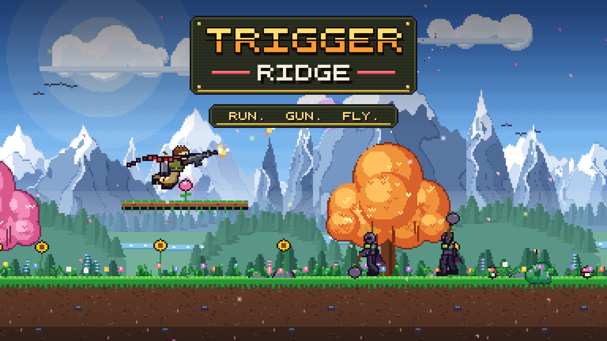
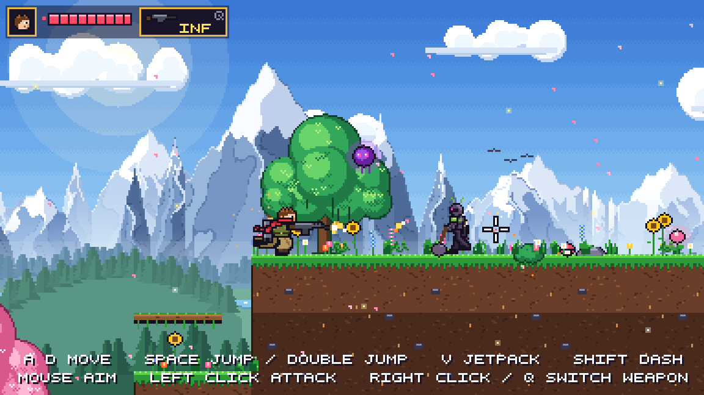
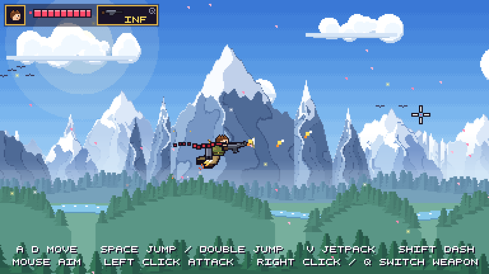
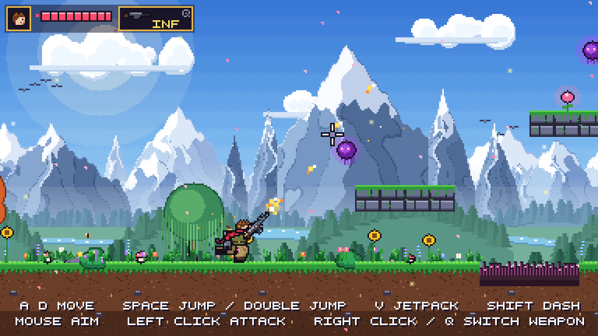
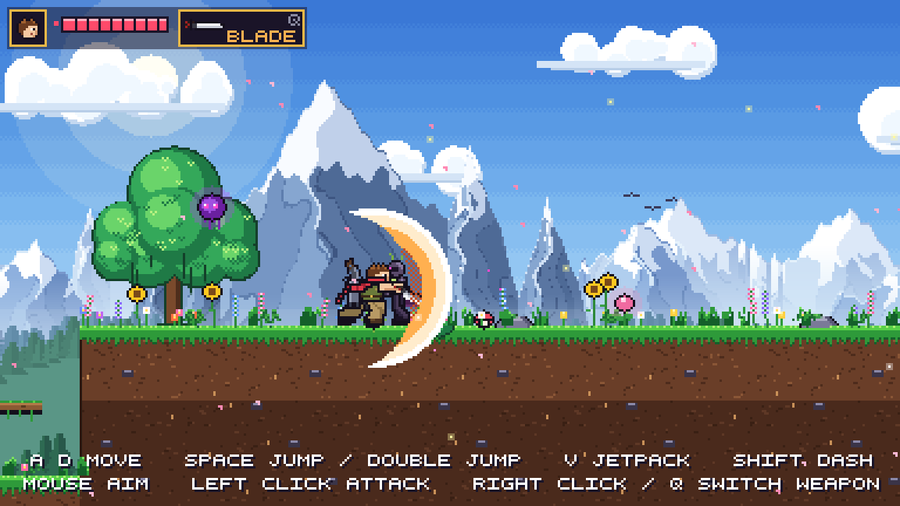

# Trigger Ridge

A pixel-art run-and-gun platformer inspired by Metal Slug. Fight through a mountain valley as a jetpack commando, armed with a heavy machine gun and a machete.

It runs in the browser using plain HTML5 Canvas and JavaScript. There's no build step and no dependencies, and all art and sound are generated in code.



## Play

Open `index.html` in any modern browser, then press **Enter** to start.

## Controls

| Input | Action |
|---|---|
| **A / D** | Move |
| **Space** | Jump; press again in mid-air to double jump |
| **V** | Jetpack on/off; fly with **W A S D** |
| **Mouse** | Aim |
| **Left click** | Attack: hold to fire the machine gun, or swing the machete |
| **Right click / Q / mouse wheel** | Switch weapon |
| **Shift** | Dash |
| **S + Space** | Drop through branches |
| **Enter** | Start / pause |

## Features

- **Heavy machine gun**: rapid fire with recoil, muzzle flash and shell casings
- **Machete**: 3-hit combo, an up-slash, and a downward thrust that bounces off enemies
- **Jetpack**: unlimited flight, plus a double jump
- **Enemies**: Thorn Knights that telegraph their swings, and Blight Wisps that fire orbs you can shoot down
- **World**: a mountain backdrop with layered scrolling, swaying plants, butterflies and a flowing river

| | |
|---|---|
|  |  |
|  |  |

## Project structure

```
index.html        page and script loading
js/main.js        game loop, camera, HUD, screens
js/player.js      player movement, weapons, jetpack
js/entities.js    enemies, bullets, pickups, checkpoint, exit
js/level.js       stage layout and tile collision
js/art.js         character rig, sprites and scenery (all drawn in code)
js/background.js  parallax mountain vista
js/audio.js       synthesized sound effects
js/input.js       keyboard and mouse
mockups/          screenshots and the cover image
```
